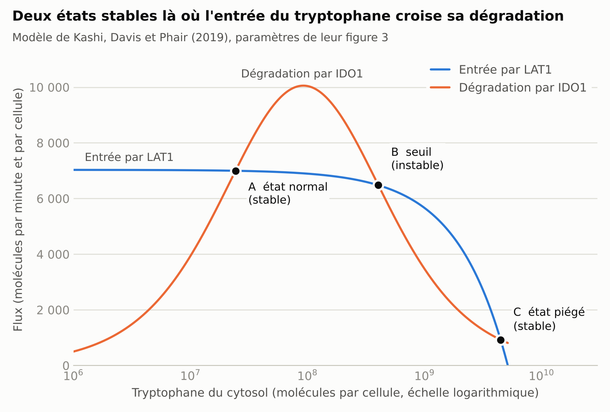

# Niveau 2 : le piège métabolique IDO

Résultats du 2026-11-22, produits par `python3 piege_ido.py`. Aucun tirage aléatoire :
le résultat est identique à chaque exécution.

**Le modèle de Kashi, Davis et Phair (2019) est reproduit aux arrondis publiés près.
Avec ses paramètres, on entre dans le piège en quelques semaines et on en sort
en mois ou en années.**

> Les leviers ci-dessous sont des paramètres d'un modèle, pas des traitements.
> « Diviser le tryptophane externe par deux » n'est pas un conseil alimentaire.
> L'article lui-même qualifie ses pistes thérapeutiques d'hypothétiques.

## Le modèle en une phrase

Le tryptophane entre dans la cellule par le transporteur LAT1 et y est dégradé par l'enzyme IDO1,
qui ralentit quand le tryptophane abonde : deux états stables coexistent, séparés par un seuil.

## 1. Reproduction de l'article

| Grandeur | Simulateur | Article |
| --- | --- | --- |
| État normal (A), molécules par cellule | 2,43 × 10⁷ | ~2 × 10⁷ (écart +21 %) |
| Seuil (B) | 4,03 × 10⁸ | non publié |
| État piégé (C) | 4,47 × 10⁹ | ~5 × 10⁹ (écart −11 %) |
| Rapport C / A | × 184 | « plus de deux ordres de grandeur » |
| Dégradation par IDO1 en C | 926 molécules par minute, contre 6 997 en A (−87 %) | « presque abolie » |
| LAT1 augmenté | seul l'état piégé subsiste, dès × 1,46 | affirmé sans chiffre |
| LAT1 diminué | seul l'état normal subsiste, dès × 0,44 | affirmé sans chiffre |

L'article ne donne A et C qu'avec un chiffre significatif. Équations et paramètres ont été
relevés sur deux rendus de l'article, qui concordent (voir `JOURNAL.md`).

## 2. Ce que le simulateur ajoute

Ces résultats ne figurent pas dans l'article, qui ne publie que des états stationnaires.

### La bistabilité n'existe que dans une fenêtre étroite

| Levier | Seul l'état normal subsiste | Seul l'état piégé subsiste |
| --- | --- | --- |
| LAT1, vitesse d'entrée | en dessous de × 0,44 | au-dessus de × 1,46 |
| Tryptophane externe | en dessous de × 0,65 | au-dessus de × 1,45 |
| Quantité d'IDO1 | au-dessus de × 2,28 | en dessous de × 0,69 |
| Acides aminés concurrents | au-dessus de × 2,28 | en dessous de × 0,69 |
| IDO2 fonctionnelle (extension) | à partir de 21 % de la capacité d'IDO1 | — |

### On entre vite, on sort lentement

| Déclencheur maintenu | Durée pour aller de l'état normal au seuil |
| --- | --- |
| LAT1 × 2 | 54 jours |
| LAT1 × 5 | 10 jours |
| Tryptophane externe × 2 | 51 jours |
| IDO1 ÷ 2 | 4 mois |
| IDO1 ÷ 10 | 45 jours |

| Intervention maintenue | Durée pour redescendre de l'état piégé sous le seuil |
| --- | --- |
| Tryptophane externe ÷ 2 | 4,7 ans |
| Tryptophane externe ÷ 10 | 20 mois |
| Acides aminés concurrents × 10 | 5,9 ans |
| IDO1 × 3 | 4,6 ans |
| IDO1 × 10 | 7 mois |
| IDO1 × 3 et tryptophane externe ÷ 2 | 17 mois |
| IDO2 à 10 % de la capacité d'IDO1 | pas de sortie |
| IDO2 à 50 % de la capacité d'IDO1 | 21 mois |

Contrôle par une seconde méthode (intégration pas à pas) : avec IDO1 × 10, arrêter à 90 %
de la durée calculée ramène dans le piège ; poursuivre à 110 % ramène à l'état normal.

## 3. Lecture

1. **Asymétrie.** À intensité comparable (un facteur 2), entrer prend environ 50 jours
   et sortir 4,7 ans. La cellule piégée doit éliminer un stock 184 fois plus grand
   avec une enzyme que ce stock inhibe.
2. **Combiner raccourcit.** IDO1 × 3 seul : 4,6 ans. Tryptophane ÷ 2 seul : 4,7 ans.
   Les deux ensemble : 17 mois.
3. **Entrée facile.** Une hausse soutenue de 46 % de l'entrée par LAT1 suffit à basculer.
   Si le modèle était juste tel quel, le piège devrait être fréquent chez les porteurs
   d'une IDO2 défaillante : c'est une prédiction à confronter aux données génétiques.
4. **IDO2.** Le piège disparaît si IDO2 garde au moins 21 % de la capacité d'IDO1 ;
   à 10 %, il subsiste. La prémisse génétique de l'article devient une prédiction chiffrée
   sur l'activité résiduelle des variants d'IDO2.

## 4. Conséquences pour le registre

- **H6 (état stable alternatif).** Le modèle va dans son sens sur la réponse en tout ou rien
  et sur la rechute en cas d'arrêt précoce. Il la nuance : un traitement bref ne suffit pas.
  L'effet d'ordre n'est pas testable ici, faute d'une seconde variable.
- **Prochain modèle.** Le réseau logique de Craddock 2015, à plusieurs variables,
  pour tester l'ordre des interventions.

## 5. Limites

- Une seule cellule, une seule variable : pas de synthèse de protéines, pas de voie
  de la sérotonine, pas de renouvellement cellulaire. L'article fait ces hypothèses.
- L'article ne dit pas comment les paramètres de sa figure 3 ont été choisis.
  Les durées sont des propriétés de ce jeu de paramètres, pas des prédictions cliniques.
- L'état des tests expérimentaux du piège IDO depuis 2019 n'a pas été instruit :
  c'est un travail de la phase 1.
- L'extension IDO2 repose sur une constante déduite, pas publiée dans les unités du modèle.
